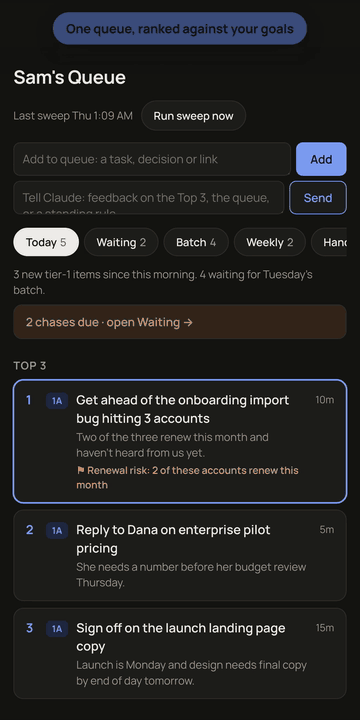

# Chief of staff for Claude

A personal chief of staff that runs inside Claude. It sweeps your email, chat, meeting notes and work tracker, ranks everything against your goals for the quarter, and gives you one short queue with a recommendation and a ready draft on each item.

You approve, delegate, snooze, re-tier or kill. Nothing ever sends on its own: every message is a draft you review and send yourself.

**[Try the live demo](https://levick-kyle.github.io/chief-of-staff/demo.html)** with made-up data, no setup needed.

## How it learns

Every override you make gets logged with why: a re-tier, a kill, a "this isn't mine." You can also tell Claude what to change on any item, and it checks your tools, redrafts and answers right on the card. Every two weeks it interviews you about those overrides and rewrites its own priority rubric, so it needs fewer corrections over time.

## What you get

- **A priorities skill** with your goals, four tiers, routing rules and standing rules, in your words
- **A private queue page** on phone and laptop: Top 3, a batch for routine work, a weekly noise list, a Waiting tab for what others owe you, and a proposed inbox cleanup you apply in one tap
- **A scheduled chief of staff** that sweeps your tools, ranks new items, answers your notes and drafts follow-ups
- **A biweekly check** that tunes the rubric from how you actually used it

## What you need

- A paid Claude plan with scheduled tasks and artifacts (claude.ai)
- At least one tool connected in Claude. It works with whatever you use:
  - Email: Gmail or Outlook / Microsoft 365
  - Chat: Slack or Microsoft Teams
  - Calendar: Google Calendar or Outlook
  - Meeting notes: Granola, Otter, Fireflies, Fathom, Zoom or Teams
  - Tracker or CRM: Linear, Jira, Asana, GitHub, Notion, HubSpot or Salesforce

## Setup (about 20 minutes)

1. Download [`chief-of-staff-setup.md`](chief-of-staff-setup.md) and [`queue.html`](queue.html).
2. Open a new Claude chat, attach both files, and send:

   > Create a skill from the SKILL.md section of this file, then run it to set me up.

3. Answer the questions. Most are tappable.
4. Save the priorities skill when Claude proposes it.
5. **Turn on automatic approval for the two scheduled tasks.** Scheduled runs happen when you're not there to approve them, so if they're set to ask first, your queue will never fill. Set up the connector lock under Safety first, so automatic runs still can't send anything.

## What to expect

- **The first week is rough.** It doesn't know your priorities yet, so expect wrong tiers and some noise. Correct freely: every re-tier, kill and note teaches it, and the first biweekly check folds those corrections in.
- **Start with one sweep a day.** Each run uses real capacity on your Claude plan. One morning sweep plus "Run sweep now" when you need it covers most people. Add more later if you want.

## Safety and privacy

- **It never sends.** The agent only reads, drafts and labels. Approving an item creates a draft; you send it.
- **Email can't give it orders.** Content from email, chat, meeting notes and docs is treated as data, never as instructions. Requests inside messages become queue items for you to decide, and anything that asks for credentials, money or data gets flagged as suspicious with no draft.
- **Recipients are checked.** Drafts only go to people already in the thread or ones you named, and a new address gets flagged.
- **Add a second lock.** In claude.ai, set your email and chat connectors' send, forward and delete tools to need approval or turn them off. The agent never calls them, but this makes sure it can't.
- **Where your data lives.** Queue items (titles, recommendations, drafts and your notes) are stored in your queue page's private database on claude.ai. Only you can read or write it. If your company has rules about work email in AI tools, check them first.
- **Everything is private to you:** the skill, the page and the scheduled tasks.

## Known limitations

- **claude.ai only.** It uses claude.ai's scheduled tasks and artifact pages, so it won't run in other AI apps or the Claude API as is.
- **Instant drafts need Gmail or Slack.** With those, Approve creates the draft on the spot. With Outlook, Teams or anything else, the next scheduled run creates it.
- **Claude's tools change.** Setup depends on how claude.ai's tools work today. If a step fails, open an issue.
- **Rankings are judgment calls.** It's a model making priority calls, not rules you can audit line by line. That's what the overrides and biweekly check are for.

## Updating and removing

- **Update the page:** download the new `queue.html` and ask Claude to republish it to your existing queue page. Your queue data stays.
- **Pause:** turn off the two scheduled tasks.
- **Remove:** delete the two scheduled tasks, delete the queue page from your artifacts (that deletes its data), and remove the priorities skill.

Version 1.2. Tested on claude.ai in November 2026.

## License

MIT
